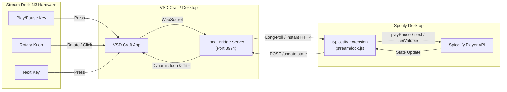

# Spicetify Stream Dock N3 Controller

Control Spotify directly from your **VSDinside Stream Dock N3** macro pad using **Spicetify**.

This integration bypasses the Spotify Web API restrictions (no Spotify Premium required, no developer client ID/secret, no sleep disconnects) by interfacing directly with your local Spotify desktop client.

---

## Architecture Overview



---

## Features

- **Play / Pause Keypad Button**:
  - Dynamically updates key icon (shows Pause icon while playing, Play icon while paused).
  - Shows current song title on the LCD key.
- **Volume Knob Control (Designed for N3 Knobs)**:
  - Rotate knob clockwise to raise Spotify volume.
  - Rotate knob counter-clockwise to lower volume.
  - Press the knob down to toggle Play / Pause or Mute.
  - Displays current volume percentage on screen.
- **Next & Previous Track Buttons**:
  - Instant track skip and return.
- **Like / Favorite Button**:
  - Toggle liked status for the currently playing track.
- **Direct HTTP Webhooks**:
  - `http://localhost:8974/playpause` (or `/toggle`)
  - `http://localhost:8974/play`
  - `http://localhost:8974/pause`
  - `http://localhost:8974/next`
  - `http://localhost:8974/prev`
  - `http://localhost:8974/volume?delta=0.05`
  - `http://localhost:8974/status`

---

## Installation & Setup

Both components are already deployed and pre-configured on your system:

### 1. Spicetify Extension
- File location:
  `C:\Users\henry\AppData\Roaming\Spotify\Apps\xpui\extensions\streamdock.js`
- Spicetify Config: `extensions = streamdock.js` (applied and active in Spotify).

### 2. Stream Dock Plugin for VSD Craft
- Plugin location:
  `C:\Users\henry\AppData\Roaming\HotSpot\StreamDock\plugins\com.vsdinside.spicetify.sdPlugin`

---

## How to Set Up Your VSDinside Stream Dock N3

### Option A: Using the Dedicated Stream Dock Plugin in VSD Craft
1. Open or restart **VSD Craft** on your computer.
2. In the right-hand panel of VSD Craft, look for the **Spotify (Spicetify)** category.
3. Drag the **Play / Pause** action onto any desired LCD key on your Stream Dock N3.
4. Drag the **Volume Control (Knob)** action onto one of your 3 rotary knobs!
5. Drag **Next Track** or **Previous Track** onto adjacent keys if desired.

### Option B: Using VSD Craft Built-in "Website" / "Open URL" Actions
If you prefer mapping directly via HTTP webhooks without third-party plugin lists:
1. In VSD Craft, add a **Website** / **Open URL** action to any key.
2. Set the URL to:
   ```
   http://localhost:8974/playpause
   ```
3. Whenever you press that key, it instantly toggles Play / Pause in Spotify!

---

## Linux Support & Setup

Because VSDinside does not release an official native Linux version of VSD Craft, this repository includes **VSDCraft Linux**: a native Python 3 + CustomTkinter + HIDAPI controller and background daemon built specifically for the Stream Dock N3 on Linux (Ubuntu, Debian, Fedora, Arch, etc.).

### Automated One-Click Linux Setup

Run the root setup script:
```bash
chmod +x setup-linux.sh
./setup-linux.sh
```

This will automatically:
1. Detect and install the Spicetify extension (`streamdock.js`) to `~/.config/spicetify/Extensions/` and apply it with `spicetify config extensions streamdock.js && spicetify apply`.
2. Deploy the StreamDock plugin bundle to `~/.config/vsdcraft/plugins/`.
3. Set up udev rules in `/etc/udev/rules.d/99-streamdock.rules` for non-root USB access to the Stream Dock N3.
4. Prepare the Python virtual environment and install dependencies.
5. Create a desktop application launcher and systemd user service.

---

### Running on Linux

#### 1. Graphical Interface (VSDCraft GUI)
Launch the controller GUI anytime:
```bash
cd vsdcraft-linux
.venv/bin/python3 -m vsdcraft
```
*(Or launch **VSDCraft Linux** directly from your application launcher/dock)*

#### 2. Headless Background Service (Runs on boot)
To have your Stream Dock N3 always ready in the background without keeping a window open:
```bash
systemctl --user daemon-reload
systemctl --user enable --now vsdcraft.service
```

#### 3. Simulation / Virtual Mode (No hardware plugged in)
```bash
cd vsdcraft-linux
.venv/bin/python3 -m vsdcraft --mock
```

---

## Verification & Status

### On Windows (PowerShell):
```powershell
Invoke-RestMethod -Uri "http://127.0.0.1:8974/status"
Invoke-RestMethod -Uri "http://127.0.0.1:8974/playpause"
```

### On Linux (curl / bash):
```bash
curl http://127.0.0.1:8974/status
curl http://127.0.0.1:8974/playpause
```
